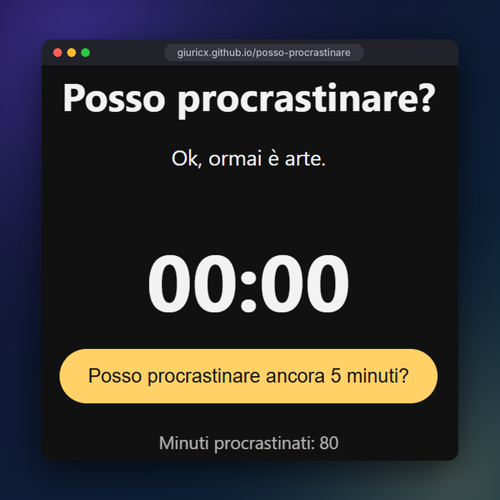

# Posso procrastinare?

  

Un sito che risponde sempre: "Sì, ma solo 5 minuti."
Poi parte un timer che ti smentisce, ogni volta.

**Provalo:** https://giuricx.github.io/posso-procrastinare/

## Come funziona
1. Clicchi il bottone.
2. Ti vengono concessi 5 minuti di procrastinazione.
3. Il timer scade e ti prende in giro.
4. Chiedi altri 5 minuti. Il contatore tiene il conto.

## Uso in locale
Nessuna dipendenza: scarica il repo e apri `index.html`.

## Note
Scritto con l'aiuto di Claude (perché siamo messi male) ma non da Claude. HTML, CSS e JavaScript puro.

## Licenza
MIT
